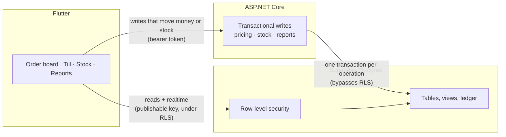

# CafeOps

Floor operations for a small cafe: a live order board, stock that moves when
things are sold, and sales reporting.

Flutter client · ASP.NET Core API · Supabase (Postgres, Auth, Realtime)

[](https://github.com/direenvy/cafeops/actions/workflows/ci.yml)
[](https://github.com/direenvy/cafeops/actions/workflows/deploy-web.yml)

**[Live demo](https://direenvy.github.io/cafeops/)** — sign up with any email.
New accounts start as staff, which is deliberate: the role is never taken from
anything the client sends, so the manager screens stay hidden until an owner
grants them.

---

## Why it is built this way

The interesting decision in this project is not what it does, it is where each
responsibility sits.

Supabase can serve a client directly, and for reads that is exactly what it
does here — including the realtime subscription that drives the order board. But
placing an order is not one insert. It is: look up the prices, work out what the
recipes consume, check the stock room can cover the whole order, write the
order, write its lines, decrement every ingredient balance, and append a ledger
row explaining each decrement. Either all of that happens or none of it does,
and no client can be trusted to do it.

So the split is:



Reads go straight to the database under row-level security, so the board updates
over a websocket with nothing polling. Writes that move money or stock have **no
RLS policy for the client role at all**, so PostgREST refuses them outright;
they are only reachable through the API, which connects as a role that bypasses
RLS and wraps each operation in a single transaction.

That is the part worth asking about in an interview, and the honest answer is in
[docs/ARCHITECTURE.md](docs/ARCHITECTURE.md): routing everything through C#
would have thrown away realtime for no gain, and using only Supabase would have
left the stock arithmetic in the client where it cannot be trusted.

## What it does

**Anyone on shift**

- Live order board. A ticket rung up at the till appears on every other screen
  in the same moment, no refresh and no polling.
- Till: pick items by category, note "oat milk, extra hot" against a line, send
  to the kitchen. The cart holds items and quantities — never prices.
- Tap a line to move it along: queued → making → ready → served.
- See what is running low, because that is useful to a barista too.

**Managers and owners**

- Take payment, which closes the order and settles the money.
- Cancel an order with a reason; the ingredients go back and the reason is
  recorded on the ledger.
- Book in deliveries, record waste, enter a stock count.
- Every ingredient's full ledger: what moved, when, why and who.
- Sales reporting: revenue by day, best sellers, average order value.

Roles live in the database, not in the token, so a demotion takes effect in
seconds rather than when the token expires.

## Stack

| Layer | Choice | Why |
|---|---|---|
| Client | Flutter 3.50, Riverpod 3 | One codebase for web, desktop and mobile; the web build is what makes it linkable |
| API | ASP.NET Core 10, Npgsql + Dapper | Explicit transactions and real SQL where correctness matters |
| Database | Supabase Postgres 17 | Managed Postgres with auth, realtime and row-level security |
| Auth | Supabase Auth, ES256 JWTs | The API validates against the project's published JWKS and holds no shared secret |
| CI | GitHub Actions | Build, analyze, test and release-build both halves on every push |

## Running it

Short version, with a database already set up:

```bash
dotnet run --project backend/src/CafeOps.Api
```

```bash
cd app && flutter run -d chrome
```

The full walkthrough — creating the database, applying migrations, seeding, and
the one credential you have to fetch yourself — is in
[docs/SETUP.md](docs/SETUP.md).

## Tests

101 tests. 97 of them need no database, no secrets and no service containers,
which is why CI runs the lot in seconds.

```bash
dotnet test backend/CafeOps.slnx
```

```bash
cd app && flutter test
```

The backend's 67 unit tests cover the domain layer, which has no I/O at all:
the pricing rules, the order validation, and the stock arithmetic. That they
need nothing to run is a deliberate consequence of keeping the rules separate
from the persistence.

The other 4 are smoke tests that run each query against a real database, and
they exist because of a failure nothing else could have caught. Npgsql
materialises a Postgres `timestamptz` as a `DateTime` while the row records
declared `DateTimeOffset`, so Dapper could not match a constructor: everything
compiled, every unit test passed, and the first real order returned a 500. A
column-to-record mismatch is only observable against a live database. They
no-op when no connection string is configured, so CI stays free of secrets;
Testcontainers is the proper fix and is still on the list.

Worth a look, because they pin down the things that would actually cost money:

- Tax is charged on the subtotal **plus** the service charge, not on the
  subtotal alone — the common shortcut, and it under-charges by 60 sen on every
  RM100.
- Rounding is away from zero, like a till, not .NET's default banker's rounding.
- Stock requirements are aggregated across lines before being checked. A latte
  and a cappuccino both draw milk, and checking each line separately would pass
  both when the stock room can only cover one.
- Exactly enough stock is not a shortage: selling the last of something has to
  succeed.

The app's 30 tests cover the cart's merging rules and the parsing boundary,
where PostgREST's snake_case and `numeric`-as-a-string meet the API's camelCase.

## Reading the code

If you have ten minutes and want the substance:

1. [`supabase/migrations/20261117000004_rls_policies.sql`](supabase/migrations/20261117000004_rls_policies.sql)
   — the security model. Which writes the client is refused, and the guard
   triggers for the column-level rules RLS cannot express.
2. [`backend/src/CafeOps.Infrastructure/Orders/OrderService.cs`](backend/src/CafeOps.Infrastructure/Orders/OrderService.cs)
   — the order transaction, including why ingredient rows are locked in id
   order and why a cancellation reads the ledger rather than recomputing from
   the recipes.
3. [`backend/src/CafeOps.Domain/Stock/StockMath.cs`](backend/src/CafeOps.Domain/Stock/StockMath.cs)
   — the stock arithmetic, pure and fully tested.
4. [`app/lib/data/orders_repository.dart`](app/lib/data/orders_repository.dart)
   — the client side of the split, and the realtime subscription.
5. [`supabase/migrations/20261117000006_harden_functions.sql`](supabase/migrations/20261117000006_harden_functions.sql)
   and `…_007_…` — the database linter's findings, fixed. The second migration
   exists because the first fix looked right and the linter still reported the
   problem.

## Layout

```
app/                        Flutter client
  lib/core/                 config, theming, API client, Riverpod wiring
  lib/data/                 repositories: Supabase reads, API writes
  lib/features/             auth, order board, till, inventory, reports
  lib/models/               models and the two parsing conventions
backend/
  src/CafeOps.Domain/       pure rules: pricing, validation, stock maths
  src/CafeOps.Infrastructure/  Npgsql + Dapper, one transaction per operation
  src/CafeOps.Api/          controllers, JWT auth, role policies
  tests/CafeOps.Tests/      71 tests: 67 unit, 4 against a live database
supabase/
  migrations/               the schema, in order; source of truth
  seed.sql                  idempotent demo data
docs/                       setup and the architectural decisions
```

## Honest limitations

Worth stating plainly rather than leaving for someone to find:

- **Payment is a state change, not a payment.** Taking money settles the order
  in the database; no card terminal or payment provider is integrated.
- **The role cache is in-process.** A demotion takes effect within 30 seconds.
  Running more than one API instance would want a shared cache, or a shorter
  window.
- **The board re-reads on change rather than patching the changed row.** Correct
  and simple at a cafe's scale; it would need to become incremental at
  thousands of open orders.
- **Database testing is only half done.** Four smoke tests exercise each query
  against a real database, which is enough to catch a column that no longer
  matches its record. But they only run where a connection string happens to be
  configured, so CI never runs them, and the RLS policies and guard triggers
  have no tests at all. Testcontainers would give CI a disposable Postgres and
  close both gaps; it is the first thing I would add next.
